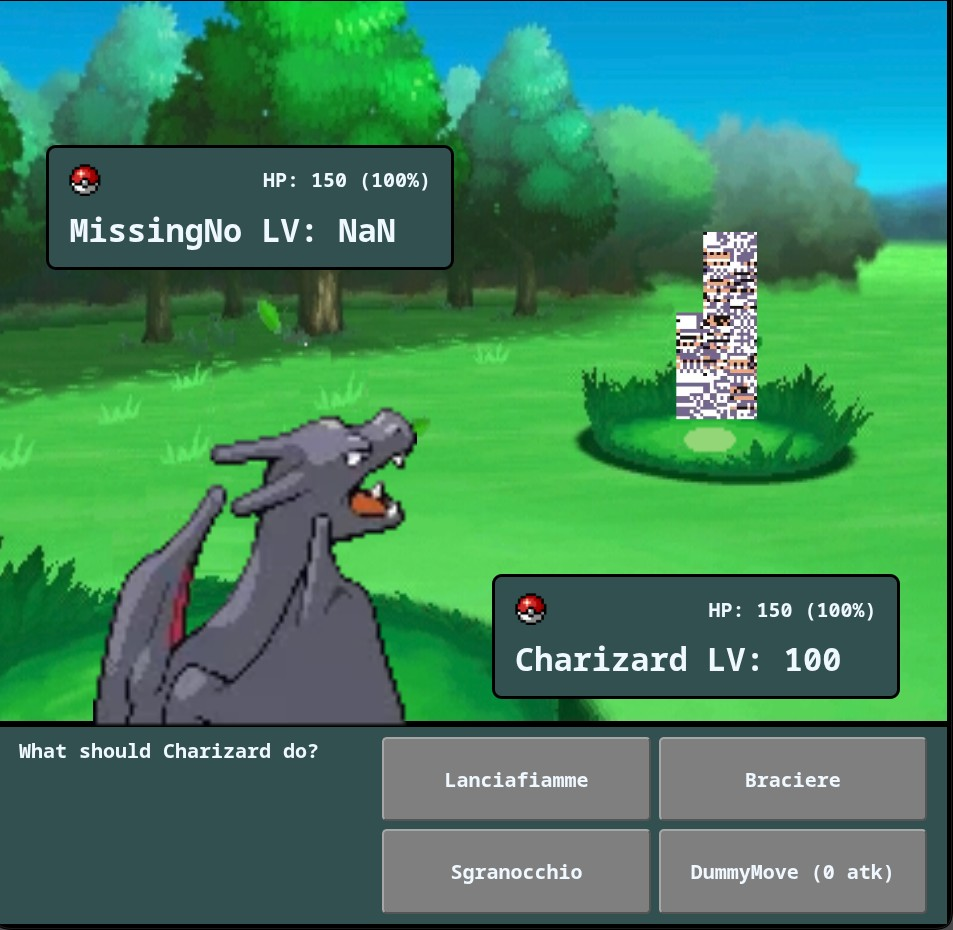

# Your Pokemon Simulator

🇮🇹 Italiano - 🇬🇧 [English](#english-version)

All'università frequento il corso di Sviluppo Applicazioni Web (SAW) e, siccome la mia professoressa sostiene che per imparare non c'è niente di meglio della pratica, ho deciso di creare un simulatore di lotte Pokémon.

Di simulatori così in giro ce ne sono a bizzeffe, però. E allora perché non lasciare che sia l'utente a importare i propri Pokémon, fatti come preferisce? Così può metterci Digimon, Fakemon e tutto quello che gli viene in mente.


Ecco un esempio del mio charizard nero che combatte contro MissingNo

## Cosa c'è (al momento)

- **Menu principale** (`main.html`)
- **Lotta offline** (`battle/`): il tuo Pokémon contro MissingNo, a turni. Scegli una delle 4 mosse, il nemico risponde con una mossa a caso e vince chi porta l'altro a 0 HP.
- **Lotta online**: in lavorazione (WIP)

## Come avviarlo

Il gioco legge `team.json` con una `fetch`, che non funziona aprendo i file con doppio clic: serve un server locale.

Serve PHP installato sul tuo computer. Apri un terminale nella cartella del progetto e scrivi:

```
php -S localhost:8000
```

poi vai su **http://localhost:8000/main.html** dal browser.

## Il tuo Pokémon

Il Pokémon del giocatore si cambia in `team.json`:

```json
{
    "Name": "Charizard",
    "Level": 100,
    "HP": 150,
    "moves": [
        { "moveName": "Lanciafiamme", "damage": 25 },
        { "moveName": "Braciere", "damage": 10 }
    ],
    "Sprite": "img/charizard.png"
}
```

- `moves`: da 1 a 4 mosse. Se ne metti meno di 4, i bottoni vuoti vengono nascosti; dalla quinta in poi vengono ignorate.
- `Sprite`: metti l'immagine nella cartella `battle/img` e scrivi qui il percorso, per esempio `img/charizard.png`.

## Struttura

```
main.html, main.css    menu principale
team.json              Pokémon del giocatore
battle/                lotta offline (pagina, stile, logica, immagini)
```

## Note legali

Si tratta di un progetto amatoriale e didattico senza scopo di lucro, non affiliato né approvato da Nintendo, Game Freak o The Pokémon Company. Pokémon e tutti i nomi, gli sprite e le immagini collegate sono marchi e proprietà dei rispettivi titolari. L'autore non si assume alcuna responsabilità per l'uso che ne viene fatto.

Il codice è distribuito con licenza MIT (vedi [`LICENSE`](LICENSE)). Le immagini in `battle/img/` sono escluse dalla licenza e appartengono ai rispettivi proprietari.

---

# English version

🇮🇹 [Italiano](#your-pokemon-simulator) - 🇬🇧 English

At university I'm taking the Web Application Development course (SAW), and since my professor says there's nothing better than practice for learning, I decided to build a Pokémon battle simulator.

There are plenty of simulators like this out there, though. So why not let users import their own Pokémon, made however they like? That way they can add Digimon, Fakemon and anything else they can think of.


Here's an example of my black Charizard fighting MissingNo

## What's in it (for now)

- **Main menu** (`main.html`)
- **Offline battle** (`battle/`): your Pokémon against MissingNo, turn by turn. Pick one of 4 moves, the enemy answers with a random move, and whoever brings the other to 0 HP wins.
- **Online battle**: work in progress (WIP)

## How to run it

The game reads `team.json` with a `fetch`, which doesn't work if you just double-click the files: you need a local server.

You need PHP installed on your computer. Open a terminal in the project folder and type:

```
php -S localhost:8000
```

then go to **http://localhost:8000/main.html** in your browser.

## Your Pokémon

The player's Pokémon is set in `team.json`:

```json
{
    "Name": "Charizard",
    "Level": 100,
    "HP": 150,
    "moves": [
        { "moveName": "Lanciafiamme", "damage": 25 },
        { "moveName": "Braciere", "damage": 10 }
    ],
    "Sprite": "img/charizard.png"
}
```

- `moves`: 1 to 4 moves. With fewer than 4, the empty buttons are hidden; from the fifth on, they're ignored.
- `Sprite`: put the image in the `battle/img` folder and write its path here, for example `img/charizard.png`.

## Structure

```
main.html, main.css    main menu
team.json              player's Pokémon
battle/                offline battle (page, style, logic, images)
```

## Legal notice

This is a non-profit hobby and educational project, not affiliated with or endorsed by Nintendo, Game Freak or The Pokémon Company. Pokémon and all related names, sprites and images are trademarks and property of their respective owners. The author takes no responsibility for how it is used.

The code is released under the MIT license (see [`LICENSE`](LICENSE)). The images in `battle/img/` are not covered by the license and belong to their respective owners.